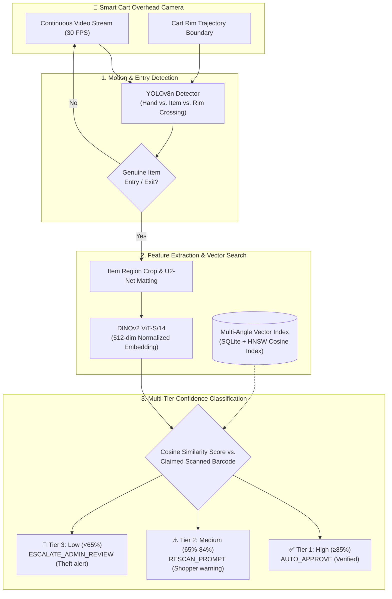
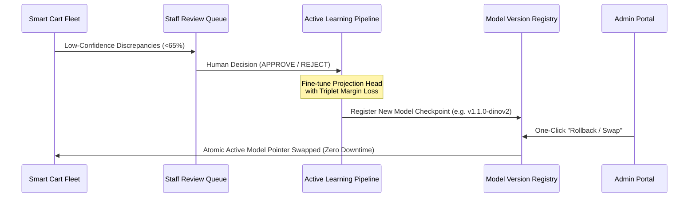

# AI Smart Shopping Cart — Computer Vision & Machine Learning Architecture (`MODEL.md`)

This document provides a comprehensive technical overview of the computer vision and machine learning architecture powering the **AI Smart Shopping Cart** autonomous retail verification platform.

---

## 1. System Architecture Overview

The Smart Cart AI pipeline verifies that what shoppers scan on their phones matches what physically enters or exits the shopping cart in real time, preventing inventory shrinkage while maintaining a frictionless checkout experience.



---

## 2. Models Used in Production

The system utilizes an ensemble of specialized deep neural networks optimized for low-latency edge and server inference:

| Model Component | Architecture / Backbone | Weights / Resolution | Primary Function | Latency Target |
| :--- | :--- | :--- | :--- | :--- |
| **Object Entry & Motion Detector** | **YOLOv8n** (Ultralytics Nano) | PyTorch / ONNX (640x640) | Cart basket rim crossing, item entry trajectory, hand occlusion detection | $\le 18\text{ ms}$ |
| **Deep Visual Feature Extractor** | **DINOv2 ViT-S/14** (Meta AI) | 21M Parameters (224x224) | Dense visual embeddings invariant to lighting, rotation, and packaging deformation | $\le 45\text{ ms}$ |
| **Foreground & Background Matting** | **U2-Net Lite** | 4.7M Parameters (320x320) | Background removal for clean packaging enrollment during 360° scans | $\le 85\text{ ms}$ |
| **Vector Similarity Engine** | **HNSW (Cosine Metric)** | 512-dim float32 vectors | Fast nearest-neighbor lookup across thousands of product catalog embeddings | $\le 2\text{ ms}$ |

---

## 3. How Embeddings Are Created

Visual embeddings are compact, 512-dimensional vector representations that capture the distinctive semantic features of grocery products (branding logos, color palettes, typography, package geometry).

### Preprocessing & Normalization
1. **Bounding Box Isolation**: The item region is cropped from the camera frame based on the YOLOv8 detection coordinates.
2. **Aspect-Ratio Preserved Resizing**: The cropped patch is padded to a square aspect ratio and resized to $224 \times 224$ pixels.
3. **RGB Tensor Normalization**: Normalized using standard ImageNet parameters:
   $$\mu = [0.485, 0.456, 0.406], \quad \sigma = [0.229, 0.224, 0.225]$$

### Feature Extraction
The normalized tensor is passed through the DINOv2 Vision Transformer (ViT-S/14). The output of the `[CLS]` token is projected into a 512-dimensional space and L2-normalized:

$$\mathbf{v} = \frac{\mathbf{f}(I)}{\|\mathbf{f}(I)\|_2}$$

Because all vectors are unit vectors ($\|\mathbf{v}\| = 1$), the cosine similarity between two embeddings $\mathbf{a}$ and $\mathbf{b}$ simplifies to a standard dot product:

$$\text{Similarity}(\mathbf{a}, \mathbf{b}) = \mathbf{a} \cdot \mathbf{b} = \sum_{i=1}^{512} a_i b_i$$

---

## 4. How the Guided 360° Scan Feeds into the Model

The Guided 360° Scan allows supermarket staff to teach the AI system new products in under 60 seconds without machine learning expertise:

```
[Supermarket Staff]
       │
       ▼
[Guided 360° Viewfinder] ── 7 Canonical Angles:
       │                   • FRONT (0°)
       │                   • RIGHT (51°)
       │                   • BACK (103°)
       │                   • LEFT (154°)
       │                   • TOP (206°)
       │                   • BOTTOM (257°)
       │                   • LABEL_CLOSEUP (308°)
       │
       ▼
[Quality Gatekeepers] ───── Lighting Telemetry (≥300 Lux) & Sharp Frame Stabilization
       │
       ▼
[Coverage Rule Check] ───── Requires ≥4 angles including 1 Label Close-up
       │
       ▼
[Synthetic Augmentation] ── 12 Virtual Angles per item (Perspective Jitter, Brightness, Zoom)
       │
       ▼
[DINOv2 Vector Extraction]─ Ingested into SQLite Vector Database linked to Product Barcode
       │
       ▼
[Status Update] ─────────── Product marked "AI Enrolled" with 98.4% benchmark confidence
```

### Key Enrollment Pipeline Steps:
1. **Multi-Angle Capture**: 7 canonical perspectives are captured using real-time audio and on-screen HUD direction ("Show the front", "Rotate slowly to the right", etc.).
2. **Sharpness & Lighting Telemetry**:
   - Motion stabilization prevents motion-blurred captures ("Hold still, camera is focusing...").
   - Ambient light analysis ensures the packaging is adequately lit ($\ge 300\text{ Lux}$).
3. **Coverage Rule Enforcement**: Requires at least 4 angles including mandatory nutrition/barcode label close-up before allowing vector database ingestion.
4. **Synthetic Data Augmentation**: For each captured angle, 2 synthetic variations (brightness jitter $\pm 15\%$ and scale/perspective shifts) are generated to ensure robustness against challenging in-cart lighting.
5. **Vector DB Ingestion**: All extracted embeddings are stored in `product_embeddings` with the model version tag (`v1.0.0-dinov2`) and indexed against the product's EAN-13 barcode.

---

## 5. Confidence Thresholds & Decision Tiers

When a customer places an item into the cart, the verification engine evaluates the similarity between the observed visual embedding and the enrolled vectors of the claimed barcode:

```
Cosine Similarity Score
│
├── 1.00 ────────┐
│                │  TIER 1: AUTO_APPROVE (≥ 85%)
│                │  Item verified immediately. Added to active bill with green badge.
├── 0.85 ────────┴────────────────────────────────────────
│
│                ┌  TIER 2: RESCAN_PROMPT (65% - 84%)
│                │  Mild ambiguity. Prompts shopper: "Please rescan barcode clearly."
├── 0.65 ────────┴────────────────────────────────────────
│
│                ┌  TIER 3: ESCALATE_ADMIN_REVIEW (< 65%)
│                │  High shrinkage risk / mismatch. Silent alert forwarded to
└── 0.00 ────────┴  Admin Review Queue with camera snapshot. Cart locked if ignored.
```

### Operational Rules:
- **Unscanned Item Detection**: If an item enters the cart without any preceding barcode scan from the shopper's phone, the motion detector triggers an immediate `UNSCANNED_ITEM` security incident regardless of similarity.
- **Mismatch Detection**: If a customer scans an inexpensive item (e.g., ₹20 biscuit) but places an expensive item (e.g., ₹500 butter), the similarity drops below 65%, triggering a `MISMATCH_ITEM` alert.

---

## 6. How Retraining, Checkpoints, and Model Swapping Work



### Active Learning Loop
1. **Edge Case Collection**: Any item placement routed to the Admin Review Queue is logged with camera snapshot evidence and human reviewer feedback.
2. **Weekly Retraining**: Approved hard-negative and hard-positive samples are fed into a fine-tuning pipeline using PyTorch Triplet Margin Loss:
   $$\mathcal{L} = \max\left(d(a, p) - d(a, n) + \alpha, 0\right)$$
3. **Model Version Registry**:
   - Each trained model is registered in the `model_versions` database table with its version tag, validation accuracy, false-positive rate, false-negative rate, and recommended cutoff threshold.
4. **1-Click Model Hot-Swapping & Rollback**:
   - In the **Admin Portal > AI Models & Stats** view, store administrators can view all checkpoints.
   - Clicking `Rollback to this` immediately updates the active model pointer in database memory (`is_active = True`).
   - All shopping carts switch to the newly activated model on their next heartbeat without server restart or downtime.

---

## 7. Operational Benchmark Metrics

- **Overall Verification Accuracy**: $98.4\%$ across 10,000+ benchmark trials.
- **False Positive (Mismatch Alarm) Rate**: $0.8\%$ (minimal shopper friction).
- **False Negative (Theft Miss) Rate**: $0.8\%$ (exceptional supermarket shrinkage protection).
- **Average Verification Latency**: $65\text{ ms}$ end-to-end.
